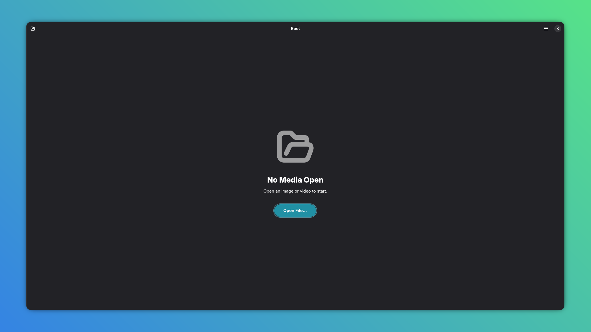
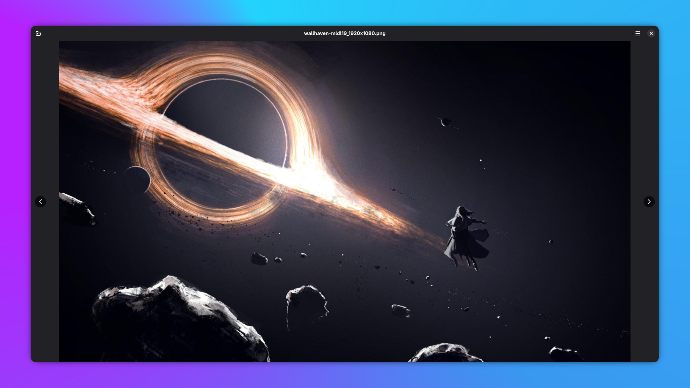
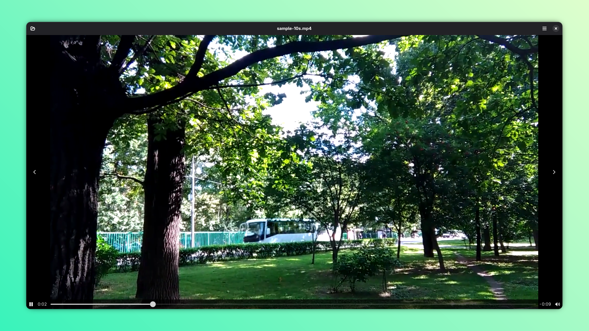

<div align="center">


# Reel

**A fast, local photo and video viewer for the GNOME desktop.**


[**Source**](https://github.com/oscar370/reel) · [**Issues**](https://github.com/oscar370/reel/issues)

</div>



<details>
<summary>More screenshots</summary>





</details>

---

## About the Project

Reel is a small media viewer for the GNOME desktop. It opens a file or folder from the command line, the app itself, or a file manager, and keeps the folder's media as a navigation list so you can move through images and clips without leaving the window.

Images are decoded by glycin, which adds support for formats beyond GTK's native decoders, including animated GIF, WebP, and AVIF.

**Status:** In development

## Features

- Browse JPG, PNG, WebP, AVIF, HEIC/HEIF, JPEG XL, GIF, BMP, TIFF, ICO, and SVG images
- Play MP4, MKV, WebM, MOV, AVI, OGV, and M4V videos
- View animated GIF, WebP, and AVIF images when the decoder reports frame timing
- Wrap-around next/previous navigation with `Left`/`Right` shortcuts
- Open files from the empty view, the header button, the command line, or a file manager
- Natural, case-insensitive ordering (`img2` before `img10`)
- Unsupported or deleted files stay in the navigation list and show a clear error page
- Auto-hiding navigation controls
- English and Spanish UI strings via gettext

## Tech Stack

| Layer | Technology | Why |
|-------|------------|-----|
| Language | Rust | Memory safety for a small native desktop app |
| UI | GTK 4 + libadwaita | Native GNOME widgets, styling, and adaptive layout |
| UI definition | Blueprint | Declarative GTK templates kept out of Rust code |
| Image decoding | glycin | Sandboxed decoding for formats GTK does not handle natively |
| Build | Meson + Cargo | GNOME resource/i18n pipeline plus Cargo dependency management |
| Internationalization | gettext | Standard GNOME translation workflow |
| Development environment | Nix + devenv | Reproducible GTK/Rust toolchain |

## Architecture

<details>
<summary>Project structure</summary>

```text
src/
├── main.rs          # gettext, resources, and application bootstrap
├── application.rs   # GApplication, file opening, and app actions
├── window.rs        # window state, navigation, async media loading, and animation
├── navigator.rs     # folder listing, natural sort, and current index
├── errors.rs        # technical errors and translated user messages
├── window.blp       # Blueprint UI source
└── reel.gresource.xml
po/                  # gettext template and translations
data/                # desktop entry, metainfo, icons, and schema
```

</details>

## Getting Started

### Prerequisites

- Linux with GTK 4 and libadwaita development files
- Rust stable and Cargo
- Meson, Ninja, `blueprint-compiler`, `pkg-config`, and gettext
- glycin build dependencies: `libseccomp`, `lcms2`, and `fontconfig`
- Runtime image loaders: `glycin-loaders` and `bubblewrap`
- Optional: Nix with devenv for a reproducible environment

### Installation

```bash
git clone https://github.com/oscar370/reel.git
cd reel
meson setup build --prefix="$PWD/build/install"
meson compile -C build
meson install -C build
./build/install/bin/reel
```

The install step is needed so the app can find its compiled resources and translations.

### Usage

```bash
reel                          # start with the empty view
reel ~/Pictures               # open a folder
reel ~/Pictures/photo.jpg     # open a file
```

Images are decoded by glycin and displayed with `Gtk.Picture`, including animated GIF, WebP, and AVIF images. Videos are played with `Gtk.Video`. Use the on-screen arrows or `Left`/`Right` to move through the folder.

### With Nix

```bash
devenv shell
build
dev
```

`build` configures and compiles the project. `dev` builds, installs, and runs Reel.

Build the installable package:

```bash
nix-build -E 'with import <nixpkgs> {}; callPackage ./package.nix {}'
./result/bin/reel
```

### Scripts

| Command | Description |
|---------|-------------|
| `build` / `dev` | devenv helper scripts for building and running |
| `meson compile -C build` | Build the project |
| `meson install -C build` | Install into `build/install` |
| `cargo test` | Run the unit tests |
| `cargo clippy` | Run the linter |
| `cargo fmt` | Format the code |
| `cargo fmt --check` | Check formatting |
| `meson compile -C build reel-pot` | Regenerate the gettext `.pot` template |
| `meson compile -C build reel-update-po` | Update the `.po` translation catalogs |

## License

Distributed under the GNU General Public License v3.0 or later. See [`COPYING`](./COPYING) for details.
